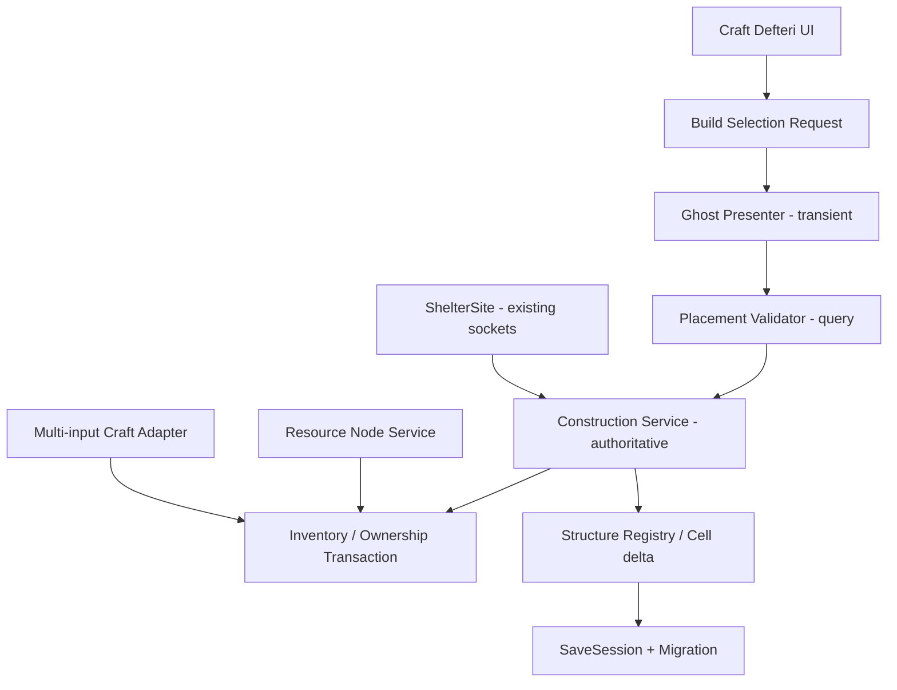

# Gerçek kaynak kodu ve hedef domain sınırları

**LS-BLD v2 governance · PROPOSED · owner acceptance pending**

> **Dayanak / durum:** Bu belge 17.10.2026 tarihli onay bekleyen LS-BLD üretim önerisinden türetilmiştir. “Mevcut” denilen sistemler GitHub `s012-integrated-graybox-slice` branch'inde incelenmiştir; yeni Construction/Harvest/Notebook tanımları **TASARIM HEDEFİ** olup kodda uygulanmış değildir. Yerel working tree uygulama gününde yeniden incelenecektir.

## Mevcut doğrulanmış kod yüzeyleri
- `ShelterRecipe`: `input`, `output`, `tool`, tek ana input, `station=Workbench`, duration ve revision validation.
- `ShelterSite`: üç authored socket gerektiren validation, station/power/fuel ve eski UI.
- `ShelterSocket`: `Physics.OverlapBoxNonAlloc` ve seçili `ShelterModule`.
- `ShelterProduction`: escrow ve save ile ilişkilendirilen çalışma durumu; `S010` raporunda test kanıtı geçmiş.
- `PlayerInventory`/`WorldItem`: stack, drop/pickup ve authoritative item sahipliği.
- `SaveSession`: save sırasında `OwnershipTransaction` ve WorldCell readiness guard.
- `WorldCellManager`: CellReady öncesi native nav registration, hydrate ve collision/nav readiness.
- `PersistentEntityId`: authored ID. Runtime construction entities için dynamic-ID kuralları ayrı tasarlanacak.

## Önerilen yeni domainler (henüz kod değil)
- `ResourceNodeDefinition`/`ResourceNodeState` (harvest).
- `RecipeDefinition` çok girdili + S010 legacy adapter.
- `BuildDefinition`, `PlacementQuery`, `PlacementResult`, `PlacementValidator`.
- `GhostPresenter` (yalnız görsel).
- `ConstructionService` (authoritative build confirmation).
- `StructureInstance` + registry + save delta/tombstone.
- `BuildZone`, original three ShelterSocket'ı değiştirmeden outdoor building policy.

## Sınır diyagramı

- UI mutation veya world duplicate owner yasak.
- Mevcut Spring/S013/S023 source scene ya da prefab restore guardları devre dışı bırakılmaz.

## Uygulama zamanı
Bu sözleşme ilgili phase/sprint/day belgelerinde referans alınır. Gerçek kodu ve yerel scene state’i implementation gününde doğrulamadan hiçbir önerilen sınıfı mevcut sayma.
