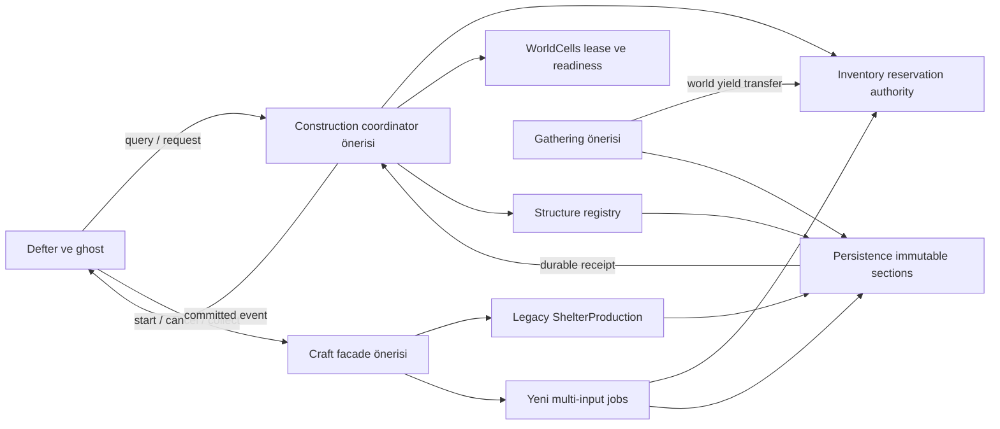

# D010 — Tek domain sahibi ve komut sınırları

BLD-P00-DEC-010 · PROPOSED, ADR-001 koşullu · Belge IMPLEMENTED / TEST_NOT_RUN.
Girdi: [gerçek API haritası](CURRENT_CODE_BOUNDARIES.md), architecture/transaction governance ve LS-DOC-07/14/17. [Kart izi](BLD_S002_HANDOFF.md). Karar sahibi Burak/teknik geliştirici; uygulama BLD-S003/005/007/009/016/021. Seçim tek state sahibi + command orchestration. Alternatif UI veya prefab callback'inde state sahipliği reddedildi; geri dönüş yeni adapter'ları kapat, eski domainleri sürdür.

## Authority matrisi — yeni isimler öneridir

| Domain | Tek yazabildiği state | Ürettiği command/event | Tükettiği | Yazamayacağı state |
|---|---|---|---|---|
| Gathering (öneri) | Node health, depletion, yield sequence, generation, lastProcessed | Harvest command handler; NodeChanged/YieldCreated | Actor/tool uygunluk, node expectedRevision | Inventory quantity veya yapı instance'ı |
| Inventory (mevcut + proposed reservation API) | Container quantity/revision; world pickup miktarı; item reservation ledger | Reserve/Transfer/Release/Consume; InventoryChanged | Craft/build material plan, world pickup | Job progress veya structure lifecycle |
| Crafting (yeni facade + legacy S010 sahibi) | Recipe seçimi, time-bound job, escrow'a ait input payload ve pending output | Start/Cancel/Collect; JobChanged | Inventory transfer receipt, canonical clock | Container slotlarını doğrudan değiştirme |
| Construction (öneri) | Build definition yorumlama, izin, structure registry/lifecycle/revision, snap occupancy | Confirm/Remove/Repair ileride; StructureCommitted/Removed | Validator, inventory reservation, cell lease, durability receipt | Shelter claim veya ayrı storage kopyası |
| Shelter (mevcut) | Claim, eski üç module, operational utility/fuel/job (legacy job sahibi ShelterProduction) | Claim/Install/utility query/event | Var olan inventory API; gelecekte structure capability projection | Dış yapı ID veya yeni node state'i |
| WorldCells (mevcut + lease önerisi) | Cell lifecycle/epoch, topology ve authority location; unloaded DTO custody | Acquire/ReleaseLease; CellReady/Leaving | Domain snapshot/hydration adapters | Başka domain'in maliyetini hesaplama veya ikinci yapı owner'ı olma |
| Persistence (mevcut + section/durability önerisi) | Save generation, immutable section bytes, durable request receipts, migration aliases | WriteGeneration/Restore; DurabilityResult | Domain DTO'ları, checksum/catalog validation | Scene object listesiyle domain gerçeğini yeniden icat etme |
| Presentation (mevcut + defter/ghost önerisi) | Transient seçim, render, focus ve localization | Query/Confirm/Cancel request | Immutable result/committed events | Quantity, claim, job, yapı veya persisted node state |

Escrow açıklaması: Crafting job, escrow item payload'unun tek sahibidir; Inventory transfer servisi ownership değişimini uygular, aynı payload'u ayrıca slotlarında tutmaz. Build reservation'da miktar kaynak container'da kalır ancak spendable dışıdır; başarılı commit'te bir kez consume edilir. `ShelterProduction` legacy job'ları için tek owner kalır; facade sadece router'dır. Yeni Crafting registry aynı legacy işi sahiplenmez. Yapı condition Construction'da; utility operational hesap Shelter'da, StructureState içine yalnız versionlı snapshot projection yazılır, ikinci canlı kaynak yaratılmaz.

## Sıra, restart ve event kuralları

Command envelope: worldId, sessionEpoch, actorId, requestNonce, payloadHash, expected domain revisions; response: outcome/reason, receiptId, observed revisions, durable generation (başarıysa). Aynı frame'de gelen komutlar tek main-thread dispatcher sırasındadır. Reentrant observer command'i aynı transaction'a giremez; kuyrukta sonraki güvenli boundary'ye veya Busy'ye gider. Network server/socket eklenmez.

Domain prepare → no-throw authoritative commit → durable generation publish → public committed event sırası [transaction belgesinde](CONSTRUCTION_TRANSACTION_SEQUENCE.md) tanımlıdır. Observer exception yakalanır ve raporlanır; bir observer'ın bozulması kaynak iadesi veya ikinci gameplay ödülü oluşturmaz. UI ilk state'i query ile alır; restore eski eventleri replay ederek noise/loot üretmez.

Disable/restart: presentation preview'u siler ve unsubscribe olur. Domain state GameObject OnDisable'da kaybolmaz; coordinator session kapsamındadır. Scene unload istekleri lease varken Busy; session kapanışı precommit abort veya durable completion/recovery bekler. Yeni sessionEpoch eski callback'leri reddeder. Restore sırasında dispatcher kapalıdır; schema/catalog → domain DTO → cell hydration → collision/nav → initial UI → input sırası tamamlanır.

Time: legacy ShelterProduction world seconds kullanır; yeni tarif `timeBasis=WorldSeconds|SimulationSeconds` belirtir. Sim süreli iş pause ve unloaded progression'da ilerlemez; dünya süreli iş canonical WorldSimulation boundary ile tek kez ilerler. İlk yeni işleme tarifi WorldSeconds önerilir. Node respawn P01'de kapalı; BLD-S020 ayrı karardır. Utility catch-up `lastProcessed` ile bir kez uygulanır, duvar saati veya render frame süreleri save'e authority olamaz.

Kabul: her state sütununda bir yazan vardır; UI veya WorldCells ikinci inventory/structure authority yaratmaz. D012/D013 exception/restart tabloları bu sahipliği değiştiremez. Owner static inceleme bekleniyor.
